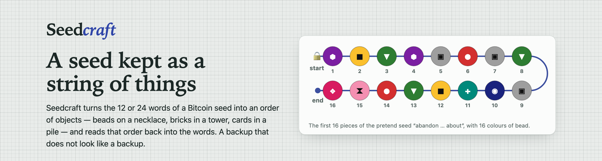
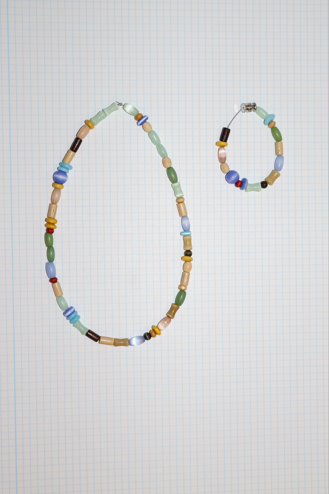
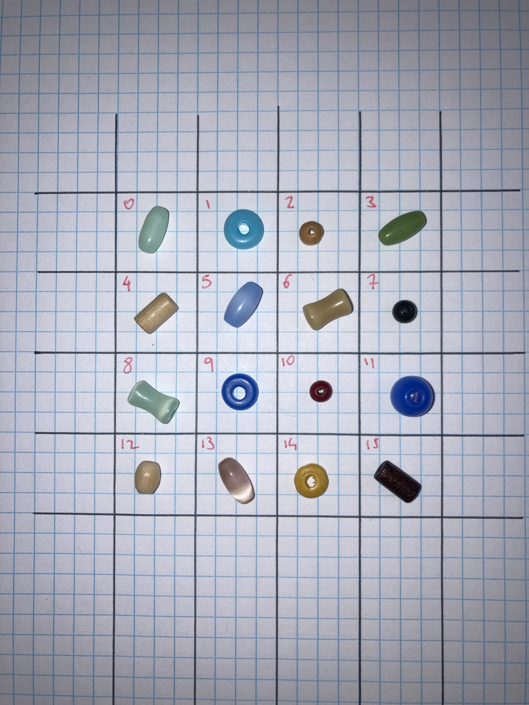
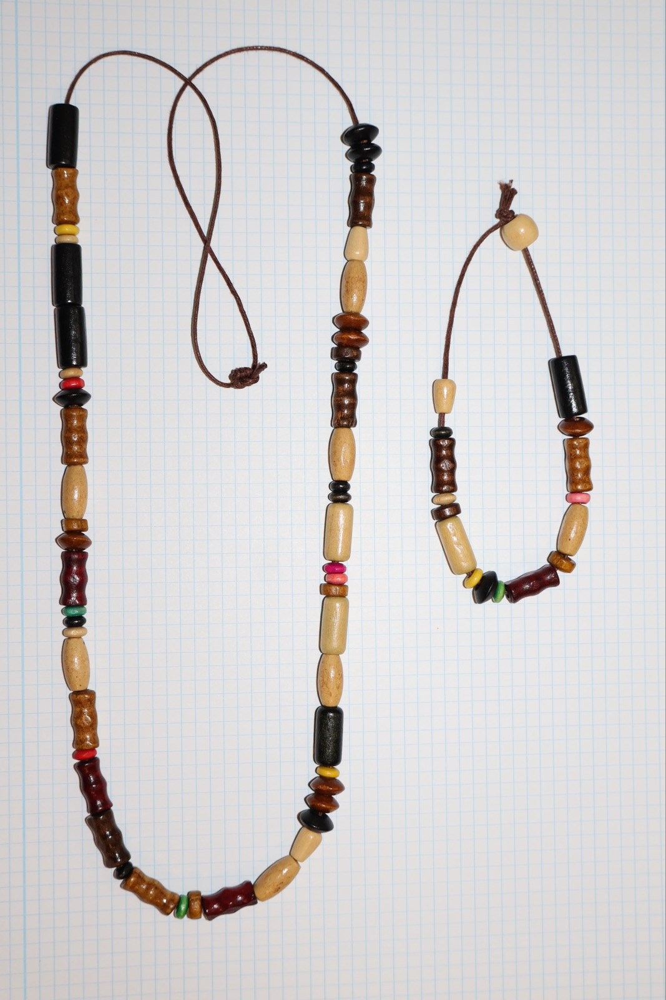
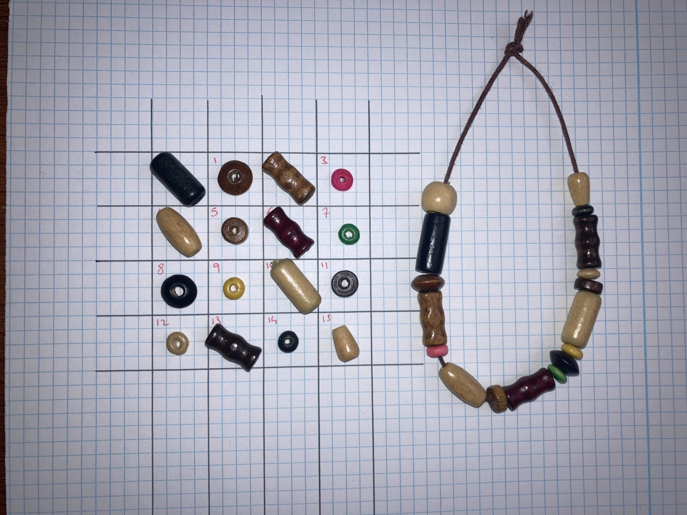
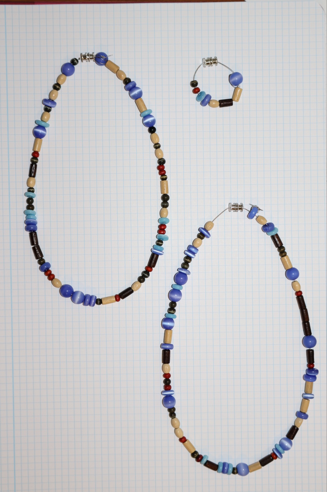
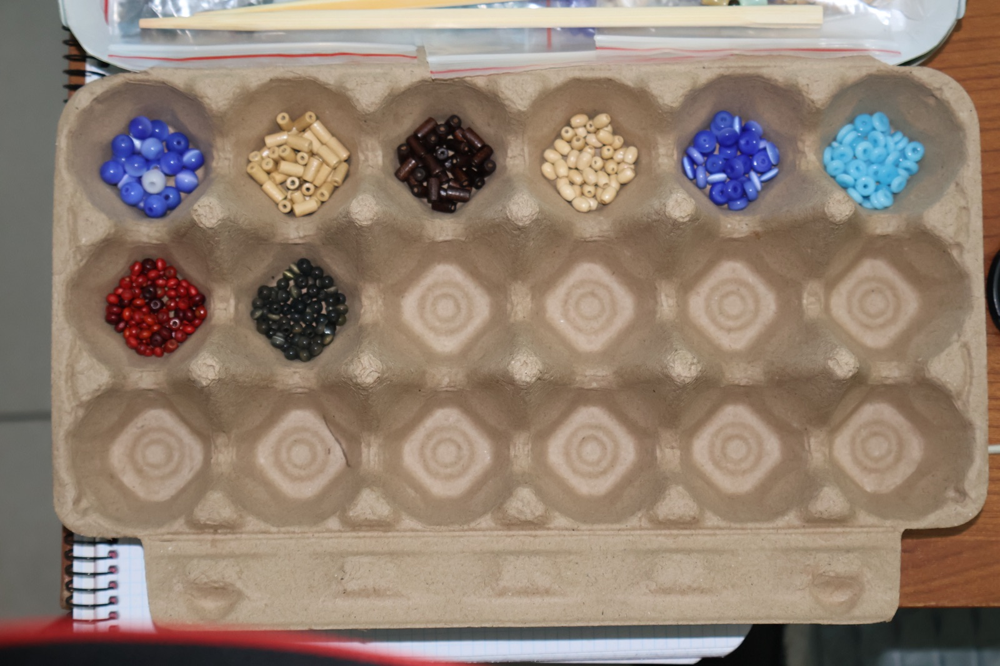

[English](README.md) · Español

*Traducción fiel del [README en inglés](README.md). Si difieren, manda la
versión inglesa.*

<picture>
  <source media="(prefers-color-scheme: dark)" srcset="docs/images/hero-dark.png">
  
</picture>

# SeedCraft

SeedCraft guarda las 12 o 24 palabras de una semilla de Bitcoin como el orden
de unos objetos: cuentas de un collar, ladrillos, pegatinas, fotos… y vuelve
a leer ese orden en palabras, con la herramienta web o **a mano** con un
lápiz. Una especificación abierta con herramientas de referencia, del
proyecto [NDS-Signer](https://github.com/ndssigner/nds-signer), pero pensada
para cualquier cartera o firmador.

## Por qué: pasa desapercibida

Frente a una copia en palabras o en QR, que cualquiera reconoce como una
semilla, una ristra bien hecha parece un collar, un álbum o una estantería.
Si se hace bien: elige una forma que tenga sentido donde la guardes.

## Cómo son

Tres ristras de muestra, todas hechas con la misma **semilla de prueba
pública** de 12 palabras. Nunca guardes así una semilla con fondos sin
cambiarla: estas fotos muestran cada pieza, en orden.

<table>
<tr>
<td width="50%"></td>
<td width="50%"></td>
</tr>
<tr><td colspan="2"><b>Sin llave, N = 16, cuentas de cristal y de madera.</b>
El collar es la semilla: 54 cuentas. La pulsera es su diccionario, los 16
tipos en orden, guardado aparte. A la derecha: los mismos 16 tipos,
numerados del 0 al 15.</td></tr>
<tr>
<td width="50%"></td>
<td width="50%"></td>
</tr>
<tr><td colspan="2"><b>Sin llave, N = 16, cuentas de madera en un cordón.</b>
La ristra larga es la semilla: 54 cuentas. La corta, con nudo, es su
diccionario. A la derecha: los 16 tipos, numerados del 0 al 15, junto a
ella.</td></tr>
<tr>
<td width="50%"></td>
<td width="50%"></td>
</tr>
<tr><td colspan="2"><b>Con llave, N = 8.</b> Dos collares de 71 cuentas
cada uno: la ristra de la semilla, ya combinada con la llave (derecha), y
la llave (izquierda). El aro pequeño es el
diccionario que comparten, los 8 tipos en orden. A la derecha: la caja de
piezas, una caja de huevos con un tipo en cada hueco.</td></tr>
</table>

## Dos modos

- **Sin llave.** Una ristra. Se guarda como se guardan las copias de una
  semilla: es la semilla. Lo que la esconde es el propio objeto, siempre que
  el diccionario no esté al lado; **no es una cerradura**: quien conozca este
  método lee la semilla de la ristra sola en una fracción de segundo
  ([SPEC §9](SPEC.es.md#9-consideraciones-de-seguridad),
  `tools/dictionary_attack.py`). Para una copia en un sitio que controlas;
  añade una frase de contraseña BIP-39 para una protección de verdad.
- **Con llave.** Dos ristras (o una ristra y un archivo) que se guardan por
  separado. Cada una sola no dice nada de la semilla; hacen falta las dos
  para reconstruirla. Para sitios que no controlas: viajes, hoteles,
  inspecciones. El precio: **perder cualquiera de las dos mitades es perder
  la semilla.** La especificación lo llama «modo con llave» (la versión inglesa, *pad mode*)
  ([SPEC §10](SPEC.es.md#10-modo-con-llave)).

La [SPEC §11](SPEC.es.md#11-elegir-modo-y-forma) ayuda a elegir
modo y forma, y dice qué no hacer.
[RISK-AUDIT.es.md](RISK-AUDIT.es.md), el modelo de amenazas, expone de qué protege cada modo y de qué no, con las pruebas.

## Cómo funciona

El CompactSeedQR de la semilla (el código QR de SeedSigner para semillas) se
lee fila a fila como bits; cada grupo de bits es uno de N tipos de cosas (se
recomiendan 16: 54 cosas para 12 palabras, 91 para 24). Un **diccionario**
(una cosa de cada tipo, en orden, guardado aparte) dice qué cosa es qué
número. Leída con el diccionario, la secuencia vuelve a dar el código QR:
dibujado en una plantilla y escaneado, o descodificado por software. Con
llave, a cada pieza se le suma un número al azar, en un reloj de N, antes de
hacerla.

Las cosas pueden ser cualquier cosa en cualquier soporte, siempre que el
orden quede fijo para siempre y ninguna pieza se pueda soltar. Ver
[SPEC.es.md](SPEC.es.md).

## A mano, o con la herramienta

Se puede hacer a mano: con la documentación, un lápiz y papel cuadriculado
para pintar el QR. Ni siquiera hace falta calculadora.

- [`docs/seedcraft-by-hand-es.pdf`](docs/seedcraft-by-hand-es.pdf)
  ([English](docs/seedcraft-by-hand-en.pdf)): de una secuencia a su código
  QR y vuelta, con un lápiz. Una guía, un ejemplo resuelto, las tablas de
  número → bits y de máscaras, una hoja de trabajo y una plantilla para cada
  tamaño y máscara con las partes fijas ya dibujadas; y, para la llave,
  cómo sacarla con dados, las tablas de sumar, el archivo de la llave y un
  ejemplo resuelto.
- [`docs/seedqr-templates-es.pdf`](docs/seedqr-templates-es.pdf)
  ([English](docs/seedqr-templates-en.pdf)): plantillas para copiar un
  SeedQR, Standard (25 × 25, 29 × 29) o Compact (21 × 21, 25 × 25), de
  SeedSigner o de un firmador compatible como NDS-Signer, con todas las
  partes fijas ya dibujadas.

Los dos miden 210 × 279 mm, para imprimir sin escalar en A4 y en US Letter,
y se generan de forma reproducible con Typst a partir de la implementación
de referencia (`docs/manual/build.sh`; la CI los comprueba byte a byte).

**La herramienta web** es una ayuda opcional y educativa:
[**ndssigner.github.io/seedcraft**](https://ndssigner.github.io/seedcraft/),
también en cada [versión publicada](https://github.com/ndssigner/seedcraft/releases)
para usarla en un ordenador desconectado. En inglés y en español. Recorre
los dos caminos, una pregunta por lámina: **guardar una semilla** (el modo,
la forma, las piezas, el diccionario, la llave, la secuencia turno a turno,
comprobarla y guardarla) y **recuperar una semilla** (cada pieza en orden,
pintando sus casillas del código QR). Cada semilla que muestra va con su
huella (BIP-32, sin frase de contraseña), para comprobar las palabras sin
leerlas en voz alta.

Es un único fichero que no puede conectarse a nada: su
Content-Security-Policy prohíbe toda petición de red, todo script externo y
`eval`; solo se ejecutan su propio script y su estilo internos, fijados por
su SHA-256. No guarda nada. Compruébalo con tu sistema operativo
(`shasum -a 256 seedcraft.html`) frente al hash publicado con la
versión; `node web/build.mjs` lo reconstruye byte a byte. La página no puede
conectarse, pero el resto de un ordenador conectado sí puede ver lo que se
escribe en ella: en un ordenador conectado, usa solo semillas de prueba.

## Despacio y con calma

Hacer la ristra como toca lleva tiempo y concentración. Dale lo que pide: un
ordenador desconectado (o lápiz y papel), tiempo, calma y las piezas a mano.
Léela entera de vuelta antes de fiarte de ella.

## Aviso

SeedCraft es un ejercicio de matemáticas con espíritu creativo y artístico, y
se ofrece tal cual, sin ninguna garantía. Nadie independiente lo ha auditado
todavía. Si lo usas con una semilla real, hazlo en un ordenador desconectado
y bajo tu propia responsabilidad. No respondemos de pérdidas de fondos ni de
ningún otro daño, ni del uso que cada cual haga de esta herramienta o de
este método.

Mientras lo usas, que nadie vea tu pantalla: muestra semillas y códigos QR
que una cámara puede captar desde lejos.

## Qué hay en el repositorio

En el repositorio está la documentación importante: el modelo de amenazas,
el desarrollo matemático del sistema y el código, abiertos a que cualquiera
los revise.

- [`SPEC.es.md`](SPEC.es.md)
  ([English](SPEC.md)): la especificación, versión 0 del formato:
  el modo sin llave y el modo con llave.
- [`RISK-AUDIT.es.md`](RISK-AUDIT.es.md) ([English](RISK-AUDIT.md)): el
  modelo de amenazas: de qué protege cada modo, y las pruebas.
- `reference/python/seedcraft.py`: implementación de referencia
  (solo la biblioteca estándar, más el generador de códigos QR de Project
  Nayuki, MIT, sin modificar); `seedcraft_pad.py`: el modo con llave, encima de
  ella.
- `vectors/seedcraft-v0.json`: vectores de prueba de semillas de prueba
  públicas (`tools/gen_vectors.py`, necesita `embit`);
  `vectors/seedcraft-pad.json`: las mismas semillas en modo con llave, con
  llaves públicas fijas (`tools/gen_pad_vectors.py`).
- `tests/test_seedcraft.py`: todos los vectores, una cosa mal leída
  reparada, cualquiera de los dos extremos, relleno aleatorio y el ataque al
  diccionario; dale un binario `qrdecode` de quirc para comprobar además que
  el código QR dibujado de vuelta es el CompactSeedQR de la semilla.
- `tests/test_pad.py`: el modo con llave frente a sus vectores, y las pruebas de
  `RISK-AUDIT.es.md` §6 (el ataque no encuentra nada, errores reparados,
  uniformidad, caracteres de control, todas las máscaras).
- `tools/dictionary_attack.py`: lee una semilla de su secuencia sin el
  diccionario (SPEC §9).
- `tools/pad_reuse.py`: por qué una llave es para una sola semilla.
- `tools/pieces_tables.py`: cuántas piezas comprar (SPEC §6, §10.6), por
  simulación.
- `web/`: la herramienta web (`web/test.mjs` la comprueba con los mismos
  vectores).
- `docs/images/samples/`: las fotos de muestra de arriba, sin metadatos.

```bash
python3 tests/test_seedcraft.py          # la referencia en Python
python3 tests/test_pad.py                # el modo pad y las pruebas de la auditoría
node web/test.mjs                        # el JavaScript (Node.js ≥ 18)
node web/build.mjs                       # dist/seedcraft.html + su SHA-256
docs/manual/build.sh                     # los PDF (Typst 0.15.1)
python3 tools/bundle.py vX.Y.Z           # el zip de la versión
python3 tools/readme_hero.py             # la imagen de este README (necesita Chrome)
```

## Descargas

Las [versiones publicadas](https://github.com/ndssigner/seedcraft/releases)
lo tienen todo en un zip reproducible: la herramienta web, los PDF y la
especificación (y, desde la próxima versión, la auditoría de riesgos), con un
`SHA256SUMS`.

## Proyectos hermanos

- [NDS-Signer](https://github.com/ndssigner/nds-signer): un firmador sin
  conexión para la Nintendo DSi, que firma PSBT por QR o por tonos.
- [ur-tones](https://github.com/ndssigner/ur-tones): PSBT y semillas como
  tonos de teléfono, por cable o al aire.

## Apoyar el proyecto

SeedCraft es gratuito y no tiene financiación. Las donaciones ayudan a
mantenerlo:

<table>
<tr><td align="center"><br><b>Bitcoin</b><br><code>bc1qx5snc0wlc8cg9gwxhyx27y6pkru8rnngyq7uja</code></td>
<td align="center"><br><b>Lightning</b><br><code>ndssigner@coinos.io</code><br><sub>LNURL (para carteras sin direcciones Lightning):<br><code>LNURL1DP68GURN8GHJ7CM0D9HX7UEWD9HJ7TNHV4KXCTTTDEHHWM30D3H82UNVWQHKUERNWD5KWMN9WGQ8XE42</code></sub></td></tr>
</table>

Las mismas direcciones que [NDS-Signer](https://github.com/ndssigner/nds-signer#donate).

## Licencia

MIT, ver [LICENSE](LICENSE). El generador de códigos QR es de Project Nayuki
(MIT): su código fuente en TypeScript y el JavaScript compilado a partir de
él con TypeScript 5.6.3 están en `web/third_party/`.
